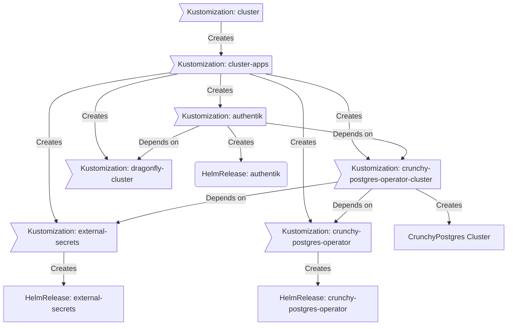

<div align="center">

### My Homelab Repository :snowflake:

_... automated via [Flux](https://fluxcd.io), [Renovate](https://github.com/renovatebot/renovate) and [GitHub Actions](https://github.com/features/actions)_ 🤖

</div>

<div align="center">

[](https://discord.gg/home-operations)&nbsp;&nbsp;
[](https://www.talos.dev/)&nbsp;&nbsp;
[](https://www.talos.dev/)&nbsp;&nbsp;
<!-- renovate: datasource=github-releases depName=fluxcd/flux2 -->
[](https://fluxcd.io/)&nbsp;&nbsp;

</div>

<div align="center">

[](https://status.ekenhome.se)&nbsp;&nbsp;
[](https://status.ekenhome.se/endpoints/infra_gatus)&nbsp;&nbsp;
[](https://status.ekenhome.se/endpoints/external_plex)

</div>

<div align="center">

[](https://github.com/kashalls/kromgo/)&nbsp;&nbsp;
[](https://github.com/kashalls/kromgo/)&nbsp;&nbsp;
[](https://github.com/kashalls/kromgo/)&nbsp;&nbsp;
[](https://github.com/kashalls/kromgo/)&nbsp;&nbsp;
[](https://github.com/kashalls/kromgo/)&nbsp;&nbsp;
[](https://github.com/kashalls/kromgo/)&nbsp;&nbsp;
[](https://github.com/kashalls/kromgo/)

</div>

---

## Overview

This is a monorepository for my home Kubernetes cluster. I try to keep everything defined as code and managed through GitOps — if it's running, it should be in Git. The main tools I rely on are [Talos Linux](https://www.talos.dev), [Kubernetes](https://kubernetes.io/), [Flux](https://github.com/fluxcd/flux2), [Renovate](https://github.com/renovatebot/renovate), [GitHub Actions](https://github.com/features/actions), [OpenTofu](https://opentofu.org/) and [Ansible](https://www.ansible.com/).

Started this to learn Kubernetes properly, and it's grown quite a bit since then — it now runs everything from media and smart home automation to a data science stack, a self-hosted LLM platform with its own GPU node, and sandboxed coding agents.

---

## ⛵ Kubernetes

### Installation

The cluster runs [Talos Linux](https://www.talos.dev), an immutable, API-driven OS purpose-built for Kubernetes. There's no SSH, no package manager — configuration is entirely declarative via `talconfig.yaml` and applied with [talhelper](https://github.com/budimanjojo/talhelper). Node-specific kernel modules and boot args (AMD microcode, `amdgpu` + ROCm args for the GPU node) come from [Talos Image Factory](https://factory.talos.dev) schematics.

The setup is semi-hyper-converged: workloads and Rook/Ceph block storage share the same nodes, while a separate NAS handles NFS/SMB shares, bulk storage, and off-cluster backups. One worker is a dedicated, tainted LLM node with an AMD Strix Halo iGPU and 128GB of unified memory.

### Core Components

- [actions-runner-controller](https://github.com/actions/actions-runner-controller): self-hosted GitHub Actions runners inside the cluster (eight runner scale sets for this repo and other projects)
- [cilium](https://github.com/cilium/cilium): CNI for internal Kubernetes networking, replacing kube-proxy entirely; also L2 announcements for LoadBalancer VIPs and network policy
- [cert-manager](https://cert-manager.io/docs/): handles SSL certificate issuance and renewal for all cluster services
- [cloudflared](https://github.com/cloudflare/cloudflared): Cloudflare Tunnel for exposing services without opening inbound firewall ports
- [envoy-gateway](https://gateway.envoyproxy.io/): primary ingress via the Gateway API — an `envoy-internal` and an `envoy-external` Gateway, with OIDC in front of apps that lack their own login
- [istio](https://istio.io/): service mesh, kept for the few workloads (Ray, Dask) that still use its gateway
- [external-dns](https://github.com/kubernetes-sigs/external-dns): automatically creates DNS records from HTTPRoute and service definitions
- [external-secrets](https://github.com/external-secrets/external-secrets/): syncs secrets from [Bitwarden](https://bitwarden.com/) into Kubernetes
- [tailscale](https://tailscale.com/): mesh VPN access into the cluster network
- [openebs](https://openebs.io/): local hostpath storage for workloads that need node-local fast storage
- [rook-ceph](https://rook.io/): distributed block storage across the cluster nodes, one NVMe OSD per node
- [sops](https://toolkit.fluxcd.io/guides/mozilla-sops/): encrypted secrets committed to Git, used across Kubernetes and Ansible
- [spegel](https://github.com/spegel-org/spegel): peer-to-peer OCI registry mirror so nodes don't all pull images independently
- [tuppr](https://github.com/home-operations/tuppr): declarative Talos and Kubernetes upgrades driven from Git
- [renovate-operator](https://github.com/mogenius/renovate-operator): self-hosted Renovate, running in the cluster on a GitHub App token
- [volsync](https://github.com/backube/volsync): backup and recovery of persistent volume claims, with a restore drill in CI

### GitOps

[Flux](https://github.com/fluxcd/flux2) watches the `kubernetes/` folder and reconciles the cluster to match whatever is in Git. The root `cluster-apps` Kustomization points at `kubernetes/apps`; each namespace has a `kustomization.yaml` listing its apps, and each app has a Flux `Kustomization` in `ks.yaml` next to the `HelmRelease` and any supporting resources. SOPS decryption and variable substitution from `cluster-settings` / `cluster-secrets` are patched onto every child Kustomization.

If it's not in Git, it doesn't run — and if it drifts, Flux will bring it back.

[Renovate](https://github.com/renovatebot/renovate) monitors the entire repository for outdated dependencies — Helm charts, container images and digests, Talos and Kubernetes versions, GitHub Actions. When a new version is available, it opens a PR automatically; `flux-local` and `kubeconform` validate the rendered manifests, and an AI review workflow checks release notes and registry tags against the PR. Merging that PR is all it takes to trigger a rollout.

### Directories

```sh
📁 .
├── 📁 .devcontainer/    # Development container configuration
├── 📁 .github/          # GitHub Actions workflows and Renovate config
├── 📁 .taskfiles/       # Taskfile includes (Flux, Talos, Rook, VolSync, Bitwarden, ...)
├── 📁 ansible/          # Ansible playbooks for supporting infrastructure
├── 📁 build/            # Custom OCI images built in CI
├── 📁 clusterconfig/    # talhelper-generated Talos machine configs
├── 📁 docs/             # Project notes (currently the Bandit ML platform)
├── 📁 kubernetes/       # Kubernetes manifests
│   ├── 📁 apps/         # Application deployments, grouped by namespace
│   ├── 📁 base/         # Gateway API CRDs
│   ├── 📁 bootstrap/    # Flux install and Talos talconfig
│   ├── 📁 flux/         # Core Flux configuration, Helm/Git repositories, vars
│   └── 📁 templates/    # Reusable components (VolSync, etc.)
└── 📁 terraform/        # OpenTofu for Authentik, Cloudflare and MinIO
```

### Flux Workflow

Here's how Flux handles deployment ordering using real examples from the cluster. `external-secrets` and the Postgres operator have no dependencies so they come up immediately. The Postgres cluster waits for both of those to be healthy, and only then can `authentik` start — since it needs a running database and a Dragonfly (Redis) cache before it can do anything useful.



---

## 🗂️ Applications

The cluster runs a wide range of workloads, organized by namespace:

### LLM Platform
Everything that serves, proxies or drives an LLM lives in the `llm` namespace. [LiteLLM](https://github.com/BerriAI/litellm) is the gateway: it fronts local models, cloud APIs and a ChatGPT subscription behind named model pools, and a [litellm-operator](https://github.com/home-operations/litellm-operator) mints a scoped virtual key per app. Local inference runs on the GPU node with [llama.cpp](https://github.com/ggml-org/llama.cpp) via [LLMKube](https://github.com/defilantech/llmkube) (ROCm on the Strix Halo iGPU), plus CPU embedding models, [ComfyUI](https://github.com/comfyanonymous/ComfyUI) for image generation, [whisper.cpp](https://github.com/ggml-org/whisper.cpp) and [Lemonade](https://github.com/lemonade-sdk/lemonade) TTS for speech. Around that: [ToolHive](https://github.com/stacklok/toolhive) runs MCP servers, [SearXNG](https://github.com/searxng/searxng) provides web search, two memory services back the agents, and [Hermes](https://github.com/NousResearch/hermes-agent), [Langflow](https://langflow.org/), [SillyTavern](https://github.com/SillyTavern/SillyTavern) and [OpenCode](https://github.com/sst/opencode) are the frontends. A nightly job writes an LLM-generated wiki of this repo, and an alert-triage service explains Alertmanager pages.

### Agent Lab
*Off since 2026-10-18 except its Trackinizer analysis ledger, which stays in use; the rest of the manifests stay for a later concept.* A sandboxed platform for autonomous coding agents: an orchestrator claims GitHub issues, runs one agent per issue in a locked-down namespace, verifies the result in a second sandbox and records everything in a Postgres ledger. Default-deny Cilium policies, resource quotas and a dedicated Envoy egress gateway (which injects the LiteLLM key, so the sandboxes never see it) keep it contained.

### Data Science
[Ray](https://www.ray.io/) for distributed compute and [Apache Spark](https://spark.apache.org/) for large-scale processing, with [Dagster](https://dagster.io/) for orchestration. [MLflow](https://mlflow.org/) handles experiment tracking, [Label Studio](https://labelstud.io/) annotation, and [Jupyter Lab](https://jupyter.org/) and [Marimo](https://marimo.io/) are the notebooks. [Qdrant](https://qdrant.tech/) is the vector database and [FalkorDB](https://www.falkordb.com/) the graph database. The Bandit contextual-bandit platform documented in `docs/` and the [Seldon Core](https://github.com/SeldonIO/seldon-core) model serving it used are off (since 2026-10-15 and 2026-10-19); their manifests stay.

### Smart Home / IoT
[Home Assistant](https://www.home-assistant.io/) is the hub, with [Z-Wave JS UI](https://github.com/zwave-js/zwave-js-ui) handling Z-Wave devices and [Music Assistant](https://music-assistant.io/) for multi-room audio, all backed by a local [Mosquitto](https://mosquitto.org/) MQTT broker. Local voice runs on [Wyoming](https://github.com/rhasspy/wyoming) services: Whisper for speech-to-text, Piper and Kokoro for text-to-speech.

### Media
[Plex](https://www.plex.tv/) for media streaming, with [Kavita](https://www.kavitareader.com/) for books and comics and [Dispatcharr](https://github.com/Dispatcharr/Dispatcharr) for IPTV. [Overseerr](https://overseerr.dev/) handles requests, [Wizarr](https://github.com/wizarrrr/wizarr) invites, [Tautulli](https://tautulli.com/) stats, and [Maintainerr](https://github.com/jorenn92/Maintainerr) library cleanup. The *arr stack ([Sonarr](https://sonarr.tv/), [Radarr](https://radarr.video/) ×2, [Prowlarr](https://github.com/Prowlarr/Prowlarr), [Bazarr](https://www.bazarr.media/), [Kapowarr](https://github.com/Casvt/Kapowarr), [Lingarr](https://github.com/lingarr-translate/lingarr), [Recyclarr](https://recyclarr.dev/), [SABnzbd](https://sabnzbd.org/)) manages downloads.

### Personal / Productivity
[Immich](https://immich.app/) for photo management, [Paperless-ngx](https://docs.paperless-ngx.com/) for documents, [Syncthing](https://syncthing.net/) for file sync, [Actual Budget](https://actualbudget.org/) for personal finance, [Outline](https://www.getoutline.com/) as a wiki, plus [PairDrop](https://pairdrop.net/), [FileBrowser](https://filebrowser.org/) and [IT-Tools](https://it-tools.tech/).

### Observability
Full monitoring stack: [kube-prometheus-stack](https://github.com/prometheus-community/helm-charts/tree/main/charts/kube-prometheus-stack) with [Grafana](https://grafana.com/) (dashboards live in Git as ConfigMaps), long-term metrics via [Thanos](https://thanos.io/), [Karma](https://github.com/prymitive/karma) for alerts, [UnPoller](https://unpoller.com/) for the UniFi gear, external health monitoring with [Gatus](https://gatus.dev/), and [Kromgo](https://github.com/kashalls/kromgo) for the README badges above.

### Development / Internal Tools
[Harbor](https://goharbor.io/) as a private OCI registry, [Redpanda](https://redpanda.com/) as a Kafka-compatible event streaming platform, [Strapi](https://strapi.io/) and [Medusa](https://medusajs.com/) for headless CMS / commerce, [Rybbit](https://rybbit.io/) for web analytics, and [Bytewax](https://github.com/bytewax/bytewax) for stream processing, plus a handful of side projects. [Authentik](https://goauthentik.io/) provides SSO for everything; [Crunchy Postgres](https://github.com/CrunchyData/postgres-operator) and [Dragonfly](https://www.dragonflydb.io/) are the shared databases.

---

## ☁️ Cloud Dependencies

Most things run locally, but I offload a few things to the cloud where it makes sense — either to avoid chicken-and-egg problems at boot time, or because they need to be available even when the cluster is down.

| Service                                   | Use                                                               | Cost           |
|-------------------------------------------|-------------------------------------------------------------------|----------------|
| [Bitwarden](https://bitwarden.com/)       | Secrets with [External Secrets](https://external-secrets.io/)     | ~$10/yr        |
| [Cloudflare](https://www.cloudflare.com/) | Domain, Tunnel and S3 (R2)                                        | ~$30/yr        |
| [GitHub](https://github.com/)             | Hosting this repository and continuous integration/deployments    | Free           |
| [Healthchecks.io](https://healthchecks.io/) | Monitoring internet connectivity and external facing applications | Free         |
| [MiniMax](https://www.minimax.io/) / [ChatGPT](https://chatgpt.com/) | Frontier models behind LiteLLM, fallback when the local GPU is down | Usage-based |
|                                           |                                                                   | Total: ~$3.33/mo + LLM usage |

---

## 🔧 Hardware

### Main Kubernetes Cluster

| Name    | Device                | CPU                                    | OS Disk                  | Data Disk (Ceph OSD)  | RAM   | OS    | Purpose           | Status (2026-10-12) |
|---------|-----------------------|----------------------------------------|--------------------------|-----------------------|-------|-------|-------------------|---------------------|
| master1 | Intel NUC12WSHi5      | i5-1240P (12c/16t)                     | —                        | 1TB Samsung 980 PRO   | 64GB  | Talos | k8s control-plane | Dead (board failure); ASRock DeskMini B760 / i3-14100 replacement on order |
| master2 | Intel NUC12WSHi5      | i5-1240P (12c/16t)                     | 200GB Intel DC S3710     | 1TB Samsung 980 PRO   | 64GB  | Talos | k8s control-plane | Ready, sole etcd member |
| master3 | Intel NUC12WSHi5      | i5-1240P (12c/16t)                     | 200GB Intel DC S3700     | 1TB Samsung 980 PRO   | 64GB  | Talos | k8s control-plane | Dead (won't power on); ASRock DeskMini B760 / i5-14400 replacement on order |
| worker3 | Minisforum MS-A2      | AMD Ryzen 9 (16c/32t)                  | 1TB Kingston Fury NVMe   | 1TB Kingston Fury NVMe | 96GB | Talos | k8s worker        | Ready |
| worker4 | Minisforum MS-S1 MAX  | AMD Ryzen AI MAX+ 395 (16c/32t), Radeon 8060S iGPU | 500GB Samsung 970 EVO Plus | 2TB Kingston NVMe | 128GB | Talos | k8s worker, dedicated LLM / ROCm node | Ready |

Live right now: 80 threads, 288GB RAM, ~3.7TB raw Ceph across three OSDs. With both replacement masters in: 112 threads, 416GB RAM.

### Supporting Hardware

| Name  | Device         | CPU           | OS Disk      | Data Disk | RAM   | OS       | Purpose               |
|-------|----------------|---------------|--------------|-----------|-------|----------|-----------------------|
| NAS   | Gigabyte C246M | E5-2680v2     | 32GB USB     | 78TB      | 128GB | Unraid   | NAS/NFS/Backup        |

### Networking/UPS Hardware

| Device                    | Purpose                               |
|---------------------------|---------------------------------------|
| UniFi UPS 2U              | UPS / PDU - Server Rack               |
| UniFi Dream Machine Pro   | Router / Gateway                      |
| UniFi USW Pro XG 24 PoE   | 24 Port 10G PoE Switch (main rack)    |
| UniFi USW 16 PoE          | 16 Port PoE Switch                    |
| UniFi USW Lite 16 PoE     | 16 Port Lite PoE Switch               |
| UniFi US 8                | 8 Port Switch                         |
| UniFi US 8                | 8 Port Switch                         |
| UniFi U7 Pro XGS          | WiFi 7 Access Point                   |
| UniFi AC Pro              | Access Point                          |

---

## 🤝 Thanks

Big shout out to original [cluster-template](https://github.com/onedr0p/cluster-template), and the [Home Operations](https://discord.gg/home-operations) Discord community.

Be sure to check out [kubesearch.dev](https://kubesearch.dev/) for ideas on how to deploy applications or get ideas on what you may deploy.

---

## 📜 Changelog

See my _awful_ [commit history](https://github.com/ekenheim/home-ops-upgrade/commits/main)

---

## 🔏 License

See [LICENSE](./LICENSE)
